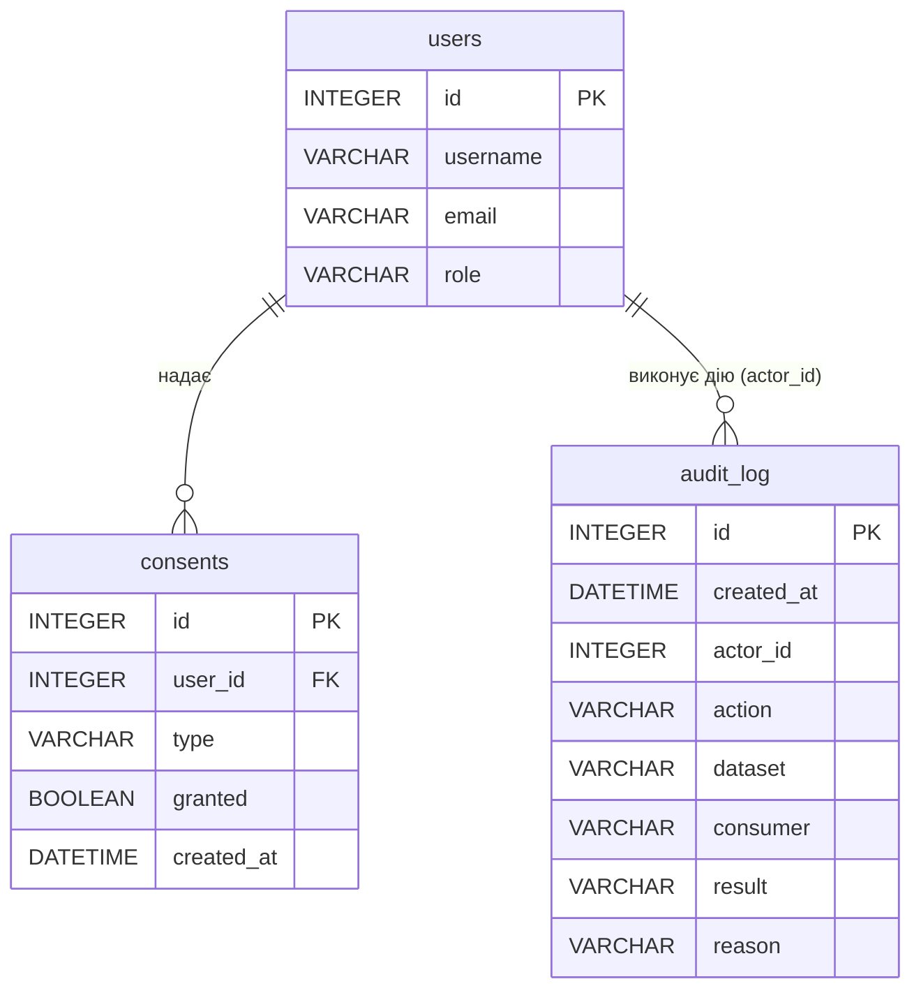

# Схема таблиць `consents` і `audit_log` (задача 4.1)

Таблиці для механізмів Data Governance в LUMI: згода на обробку даних (DG) і журнал аудиту.
За цією схемою реалізуються задачі 5.2 (API згод), 5.4 (`audit_log`) і 5.7 (передача профілю в LUMI AI).



## 1. Таблиця `consents`

| Поле | Тип | Обмеження | Опис |
|---|---|---|---|
| `id` | INTEGER | PK, AUTOINCREMENT | ідентифікатор запису |
| `user_id` | INTEGER | NOT NULL, FK → `users.id`, ON DELETE CASCADE | чия згода |
| `type` | VARCHAR(50) | NOT NULL, одне з допустимих значень | на що згода |
| `granted` | BOOLEAN | NOT NULL, 0 або 1 | 1 — згоду надано, 0 — відкликано |
| `created_at` | DATETIME | DEFAULT CURRENT_TIMESTAMP | коли надано або відкликано |

### Допустимі значення `type`

| Значення | Що означає | Обов'язкова? |
|---|---|---|
| `data_processing` | згода на обробку персональних даних (акаунт, відповіді тесту) | так, без неї реєстрація неможлива |
| `ai_profile_sharing` | згода на передачу профілю шкіри в LUMI AI | ні, вмикається на сторінці «Мої згоди» |

### Як зберігається відкликання

Рішення: **кожна зміна — новий запис** (історія не перезаписується).

- Надати згоду → `INSERT ... granted = 1`.
- Відкликати → `INSERT ... granted = 0`.
- Поточний стан = **останній** запис для пари (`user_id`, `type`). Немає записів → згоди немає.

Чому так: видно, коли згоду надали і коли відкликали (вимога задачі 5.2 і Закону «Про захист персональних даних»), а `UPDATE` стер би цю історію.

```sql
-- поточний стан згоди користувача
SELECT granted FROM consents
WHERE user_id = ? AND type = ?
ORDER BY created_at DESC, id DESC
LIMIT 1;
```

## 2. Таблиця `audit_log`

| Поле | Тип | Обмеження | Опис |
|---|---|---|---|
| `id` | INTEGER | PK, AUTOINCREMENT | ідентифікатор події |
| `created_at` | DATETIME | DEFAULT CURRENT_TIMESTAMP | коли сталася подія |
| `actor_id` | INTEGER | NULL дозволено, **без** FK | хто виконав дію (`users.id`); NULL — невідомий користувач |
| `action` | VARCHAR(50) | NOT NULL, одне з допустимих значень | що зробили |
| `dataset` | VARCHAR(50) | NOT NULL, одне з допустимих значень | з якими даними |
| `consumer` | VARCHAR(50) | NULL дозволено | кому передано дані (для обміну) |
| `result` | VARCHAR(20) | NOT NULL, одне з допустимих значень | результат |
| `reason` | VARCHAR(255) | NULL дозволено | коротка причина відмови, без персональних даних |

Що свідомо **не** зберігається: email, ім'я, пароль, вміст відповідей і профілю (мінімізація даних). Тільки `actor_id`.

Чому `actor_id` без зовнішнього ключа: після видалення акаунта записи журналу (зокрема сама подія `user_deleted`) мають залишитися, а `ON DELETE CASCADE` видалив би їх.

### Допустимі значення `action`

| Значення | Коли пишеться |
|---|---|
| `register` | реєстрація (email, Google, Apple) |
| `login` | вхід |
| `consent_granted` | надано згоду |
| `consent_revoked` | відкликано згоду |
| `quiz_saved` | збережено або оновлено відповіді тесту |
| `profile_shared` | спроба передати профіль у LUMI AI (UC-07) |
| `audit_viewed` | перегляд журналу аудиту |
| `user_deleted` | видалення акаунта |

### Допустимі значення `dataset`

`account`, `quiz_answers`, `skin_profile`, `consents`, `audit_log`

### Допустимі значення `consumer`

`LUMI AI` — для `profile_shared`; в інших подіях NULL.

### Допустимі значення `result`

| Значення | Що означає | Приклад |
|---|---|---|
| `success` | дію виконано («передано») | профіль передано в LUMI AI |
| `denied` | відмовлено через доступ або згоду («відхилено») | немає згоди → 403; не admin відкрив журнал → 403 |
| `invalid` | дані не пройшли валідацію (JSON Schema) | у профілі зайве поле → 422 |
| `error` | технічна помилка | LUMI AI не відповів |

## 3. SQL для `database.py`

```sql
CREATE TABLE IF NOT EXISTS consents (
    id INTEGER PRIMARY KEY AUTOINCREMENT,
    user_id INTEGER NOT NULL,
    type VARCHAR(50) NOT NULL
        CHECK (type IN ('data_processing', 'ai_profile_sharing')),
    granted BOOLEAN NOT NULL CHECK (granted IN (0, 1)),
    created_at DATETIME DEFAULT CURRENT_TIMESTAMP,
    FOREIGN KEY (user_id) REFERENCES users(id) ON DELETE CASCADE
);

CREATE INDEX IF NOT EXISTS idx_consents_user_type
    ON consents (user_id, type, created_at);

CREATE TABLE IF NOT EXISTS audit_log (
    id INTEGER PRIMARY KEY AUTOINCREMENT,
    created_at DATETIME DEFAULT CURRENT_TIMESTAMP,
    actor_id INTEGER,
    action VARCHAR(50) NOT NULL
        CHECK (action IN ('register', 'login', 'consent_granted', 'consent_revoked',
                          'quiz_saved', 'profile_shared', 'audit_viewed', 'user_deleted')),
    dataset VARCHAR(50) NOT NULL
        CHECK (dataset IN ('account', 'quiz_answers', 'skin_profile', 'consents', 'audit_log')),
    consumer VARCHAR(50),
    result VARCHAR(20) NOT NULL
        CHECK (result IN ('success', 'denied', 'invalid', 'error')),
    reason VARCHAR(255)
);

CREATE INDEX IF NOT EXISTS idx_audit_created ON audit_log (created_at);
```

## 4. Приклади записів

| created_at | actor_id | action | dataset | consumer | result | reason |
|---|---|---|---|---|---|---|
| 2026-11-25 10:00 | 7 | `register` | `account` | | `success` | |
| 2026-11-25 10:00 | 7 | `consent_granted` | `consents` | | `success` | |
| 2026-11-25 10:05 | 7 | `profile_shared` | `skin_profile` | LUMI AI | `denied` | немає згоди ai_profile_sharing |
| 2026-11-25 10:06 | 7 | `consent_granted` | `consents` | | `success` | |
| 2026-11-25 10:06 | 7 | `profile_shared` | `skin_profile` | LUMI AI | `success` | |
| 2026-11-25 10:10 | 3 | `audit_viewed` | `audit_log` | | `denied` | роль user, потрібна admin |

## 5. Погодження

- [ ] Настя погодила схему (коментар у задачі 4.1) перед стартом 5.2
- [ ] Після злиття 5.2 і 5.4 схему звірено з реальними таблицями
