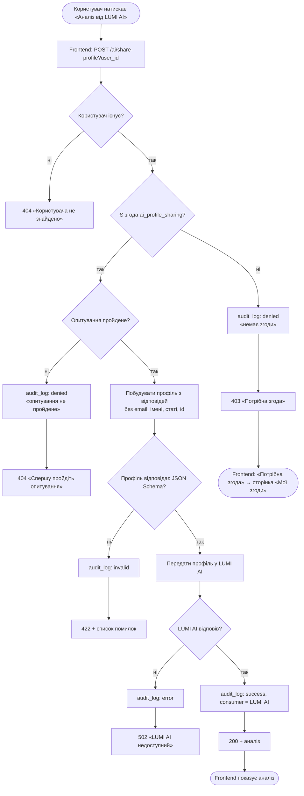

# UC-07. Діаграма активностей: передача профілю в LUMI AI (задача 4.3)

Реалізація: `POST /ai/share-profile` (backend/lumi_ai.py, #144).

## Пояснення

- Перевірки йдуть у фіксованому порядку: користувач → згода → профіль → схема → LUMI AI.
- Кожна спроба передачі (успішна чи ні, крім неіснуючого користувача) записується в `audit_log` з `action = profile_shared`.
- У LUMI AI потрапляють лише поля зі схеми профілю (мінімізація даних).